<!--
status: rewritten
reviewed-against: 2.4-main @ 35f103b1b3
reviewed: 2026-09-10
screenshots: ok
-->
# Tools

The tool pipeline is how a tool gets from a developer's registration form to a
launchable resource page on the hub. This page walks the pipeline from the
administrator's side.

Skip it unless your hub hosts tools people run in the browser. Plenty of hubs
are a website with datasets and documentation on it, and they never see any
of these screens. If yours does host tools, this is the longest recurring job
in the book: a tool moves through nine states, the developer and the
administrator take turns, and each of your turns is a button press followed
by reading what came back.

The shape to hold on to is that the pipeline alternates. The developer
registers; you create the repository. The developer uploads code; you install
it. The developer writes the tool page and approves; you publish. Nothing
advances on its own, so a tool sitting in the pipeline is always waiting for
one named side, and the pipeline listing marks which.

> **Important:** Only the CMS half of the pipeline lives in this repository.
> The pipeline calls out to host scripts — `addrepo.sh`, `installtool.sh`,
> `git2git.sh`, `git2svn.sh`, `invoke_app` — and to the middleware that starts
> tool sessions. Those belong to the tool platform, are installed on the hub's
> hosts, and could not be verified here. Sections below that describe what
> happens on the execution host are marked.

## The pipeline

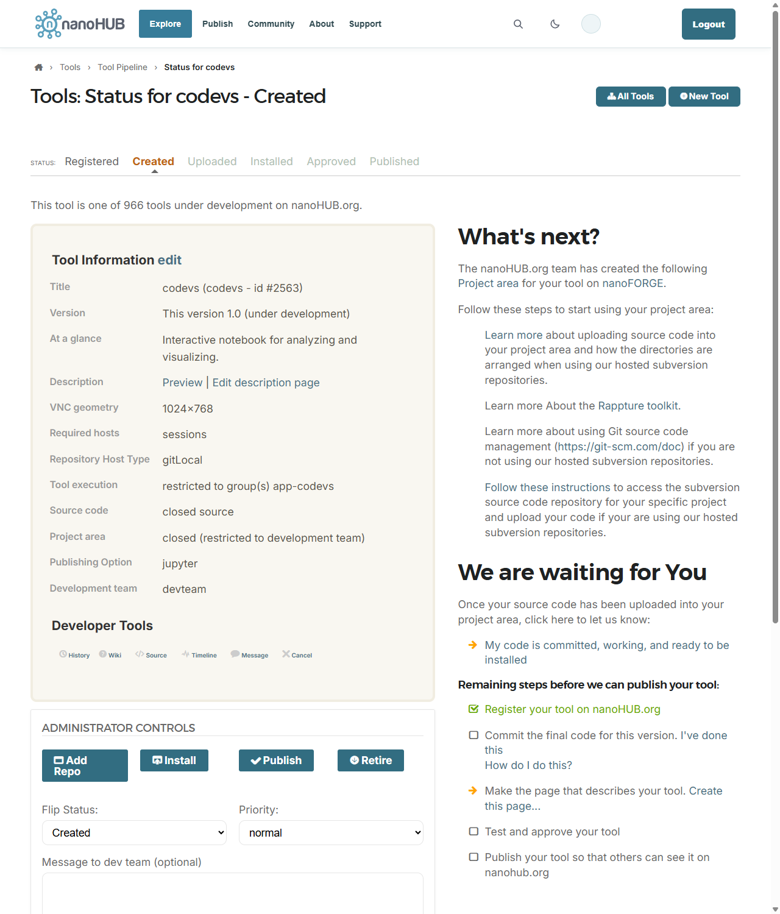

A tool has nine states. The number is the `state` column on `#__tool`:

| # | State | Set by | Meaning |
|---|---|---|---|
| 1 | Registered | Developer | The contribution form is submitted |
| 2 | Created | Administrator | The project area and repository exist |
| 3 | Uploaded | Developer | Code is committed and ready to install |
| 4 | Installed | Administrator | Code is built and installed on the hub |
| 5 | Updated | Developer | New code committed; reinstall needed |
| 6 | Approved | Developer | Tool page and license done; ready to publish |
| 7 | Published | Administrator | Live on the hub |
| 8 | Retired | Administrator | Page remains, tool can no longer be run |
| 9 | Abandoned | Developer | The contribution was cancelled |

Each state carries tasks for one side or the other. This page calls the
developer's tasks *user tasks* and the administrator's *admin tasks*.

> **Note:** **Abandoned** is not on the administrator's status drop-down.
> A tool reaches it only when a developer cancels the contribution, which is
> refused once the tool has been published.

## Preparation

Do this before anything else, because the symptom of getting it wrong is that
the pipeline appears to be empty and there is nothing on screen to say why.

Administrator controls on the pipeline are not granted by the ordinary
component ACL. They are granted by membership of the hub group named in
`com_tools`' **Admin Group** option, which defaults to `apps`:

<!--include: core/components/com_tools/site/controllers/admin.php:952-968-->

While that option has a value, membership of the group is the *only* way to
get those controls; a Super User outside the group sees none of them. Clear
the option and the component falls back to the normal permission checks.

To add someone to the group:

1. In `/administrator`, go to **Components → Groups**.
2. Search for `apps` (or whatever the **Admin Group** option names).
3. Open the group's membership.
4. Add the administrator's username as a **Member**.

## Registering a tool

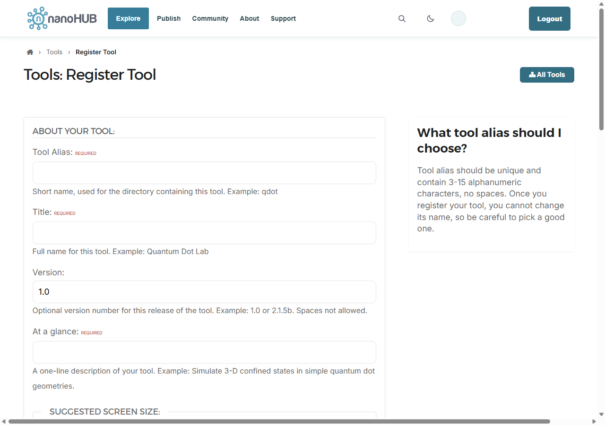

Registration is a user task. The developer starts the contribution flow on the
hub and chooses the tool contribution type, which lands on the registration
form (`/tools/create`). The pipeline listing at `/tools/pipeline` also has a
**New Tool** button that goes straight there.

The form asks for:

**About your tool**

| Field | Notes |
|---|---|
| **Tool Alias** | 3–15 alphanumeric characters, no spaces. Becomes the tool's directory name. **Cannot be changed once registered** |
| **Title** | The full display name |
| **Version** | Optional, e.g. `1.0`. No spaces |
| **Description** | One line |
| **Development team** | Usernames allowed to modify the code |
| **Application Screen Size** | Width and height in pixels; defaults from the **Default VNC Size** option |
| **Required hosts** | Comma-separated session host types; defaults from **Default Required Host Types** |

**Access**

| Field | Options |
|---|---|
| **Tool Access** | Anyone can run tool; restricted to US users (export control); restricted to users on Purdue campus; or restricted to named groups |
| **Source Code Access** | Open to public, or closed (restricted to development team) |
| **Project Area Access** | Open to public, or closed |

**Repository Host** — this is new since the guide was first written, and it
decides which of the upload instructions below apply:

| Option | Label on screen |
|---|---|
| `gitExternal` | Host Git repository on GitHub, GitLab, etc. |
| `gitLocal` | Host Git repository here |
| `svnLocal` | Host subversion repository here |

`gitExternal` is the default when the component's **External GitHub Repo**
option is on, and it adds a field for the external repository URL. The
Subversion instructions later on this page apply only to `svnLocal`.

**Publishing Option**

| Option | Label on screen |
|---|---|
| `standard` | Rappture or Linux-GUI based tool |
| `jupyter` | Web application (Jupyter, Rstudio, ...) |
| `simtool` | Sim2L |

The Jupyter and Sim2L choices appear only when the matching component options
are on; Sim2L additionally requires the platform's `invoke.simtool` template
to be present on the host.

Everything except the tool alias can be changed later. **Register Tool**
submits the form and puts the tool in the **Registered** state.

For the full option list see the
[generated `com_tools` parameter reference](../../reference/configuration/components/tools.md).

## Registered to Created

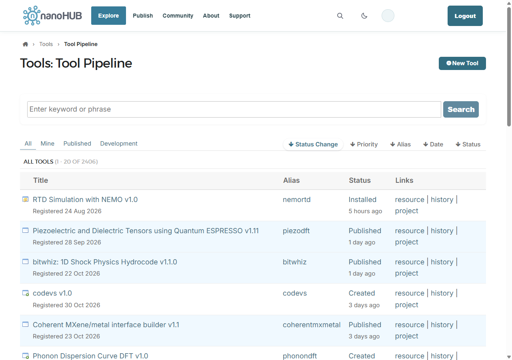

This is an admin task. Go to `/tools/pipeline`. The page lists every tool
contribution on the hub, with **Filter by** (All tools, My submissions,
Published tools, Tools under development) and **Sort by** (Status, Registration
date, Tool alias). Tools needing attention are highlighted.

If a registered tool does not appear, the account is probably not in the admin
group — see **Preparation**.

Click the tool alias to open its status page. The status page has three parts:
the tool's registration details, **Developer Tools** on the left (Wiki, Source
code, Timeline, Message, and Cancel while the tool is still under
development), and **What's next?** on the right, which lists the remaining
steps and marks off the ones already done.

Below the developer tools, administrators get an **Administrator Controls**
panel with four buttons — **Add Repo**, **Install**, **Publish**, **Retire** —
and a form carrying **Flip Status**, **Priority**, an optional message to the
development team, and an **Apply change** button.

Press **Add Repo**. That runs the host's `addrepo` script, which creates the
source code repository and project wiki and sets up access for the development
team. The results come back in the page: a green box means it worked, a red
box lists the errors. Running it again is safe — existing pieces are not
overwritten.

> **Note:** `addrepo` and everything it creates belong to the tool platform,
> not the CMS. The CMS only builds the command line and reports what came
> back, so nothing about the repository or wiki layout could be verified here.

Then set **Flip Status** to **Created** and press **Apply change**.

## Created to Uploaded


Uploading the source is a user task. In the **Created** state the **What's
next?** panel links to the project's Getting Started wiki page and, under
**We are waiting for You**, offers the flip link *"My code is committed,
working, and ready to be installed"*.

The rest of this section is the platform's tool-packaging convention, quoted
from the original guide. It describes what the developer does inside a
workspace on the execution host, and none of it is verifiable from the CMS
repository. Steps 2 to 6 below were run in a nanoHUB workspace in November
2026, building the Rappture curve example into a scratch directory, and the
two corrections that needed are made where they apply.

There are four requirements for installing a tool in the hub environment:

1. Source code
2. Graphical user interface
3. Makefile
4. Invoke script

Source code includes all files related to running the application, with
`tool.xml` and possibly a wrapper script as the exceptions. No binaries built
from the source should be stored in the repository. Binary data files such as
images are fine; committed build products are not, because they cause
compatibility problems later even when they claim to be platform independent.

All tools need a graphical user interface. Qt, GTK, wxWidgets, and Tcl/Tk all
work. If the tool has none, [Rappture](http://rappture.org) will build one
that guides users through running the tool and viewing results, and it has
hooks into the hub infrastructure.

All tools need a Makefile, which holds the instructions for compiling and
installing binaries. Tools with nothing to compile still need one.

All tools need an invoke script, which says how to launch the tool in the hub
environment. It is usually a one-line call to the hub's own invoke script.

There are eight steps to getting source code into the repository:

1. Check out a copy of the tool's source code repository.
2. Add source code to the `src` directory.
3. Add a Makefile to the `src` directory.
4. Add `tool.xml` to the `rappture` directory.
5. Check the `middleware/invoke` script.
6. Test the code in the workspace.
7. Clean the directories before committing.
8. Commit the changes.

All of them can be done from within a workspace.

> **Note:** Steps 1, 7, and 8 below use Subversion commands. They apply only
> when the tool's **Repository Host** is *Host subversion repository here*.
> For either Git option the developer uses `git clone`, `git add`, and
> `git commit`/`git push` against the repository the project area names; the
> intervening steps are the same.

### 1. Check out the repository

```
svn checkout https://yourhub.org/tools/toolname/svn/trunk toolname
```

Replace `yourhub.org` with the hub's hostname and `toolname` with the tool
alias. Run inside a workspace, this puts a local copy of the repository in a
directory named for the tool.

### 2. Add source code

```
cd toolname
cp /apps/rappture/examples/zoo/curve/curve.tcl src/curve.tcl
svn add src/curve.tcl
```

Every file has to be added, one by one or by directory.

### 3. Add a Makefile

```
gedit src/Makefile
```

```make
all: curve.tcl

install: curve.tcl
	install --mode 0644 -D curve.tcl ../bin/

clean:

distclean: clean
	rm -f ../bin/curve.tcl
```

Here the source is a single Tcl script, so `all` is empty. Code that needs
compiling would put its compile line — `gcc -o curve curve.c` — under `all`.
`install` puts executables and scripts into `../bin` with the right
permissions. `clean` removes build leftovers. `distclean` calls `clean` and
then removes whatever `install` produced, so that running it returns the
working copy to the state it was checked out in.

Save the file and `svn add src/Makefile`.

### 4. Add `tool.xml`

```
cp /apps/rappture/examples/zoo/curve/tool.xml rappture/tool.xml
svn add rappture/tool.xml
```

The example's `tool.xml` runs `tclsh @tool/curve.tcl @driver`, and `@tool`
is the `rappture` directory. With the Makefile above installing the script
into `bin`, change the command to `tclsh @tool/../bin/curve.tcl @driver`.

### 5. Check the invoke script

The `middleware` directory must contain a file named `invoke`. If it is
missing, create it and add it to the repository the same way as the Makefile.
The invoke script sets up the environment and launches the tool when a user
presses **Launch tool**. The default is:

```sh
#!/bin/sh

/usr/bin/invoke_app "$@" -C rappture -t toolname
```

`/usr/bin/invoke_app` is the platform's own invoke script; `-C rappture`
starts the Rappture interface from `rappture/tool.xml`. Older tools call
`/apps/rappture/invoke_app` or `/apps/invoke/invoke_app` instead. On
nanoHUB's 64-bit execution environment, checked in November 2026, those
paths no longer launch anything: they print a message asking for the
`/usr/bin/invoke_app -C rappture` form and exit.

The common flags of `invoke_app`:

```
-r  Rappture version (current, dev)
-t  tool name
-T  tool root directory
-e  environment variable to set
-p  add a path to the PATH environment variable
-C  command to launch the tool
-A  additional arguments to add to the command for launching the tool
-c  commands to start in the background before launching the tool, like filexfer
```

The script itself documents the rest. Finally, make it executable:

```
chmod 755 middleware/invoke
```

### 6. Test in a workspace

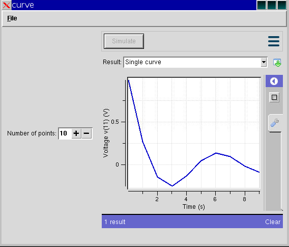

```
cd src
make all install
cd ../
./middleware/invoke -T $PWD
```

`-T` names the tool root directory, and `$PWD` is it. When the GUI appears,
run a simulation and check the result.

This step matters: it is the same sequence the administrator runs when
installing the tool on the hub. Anything that fails here fails there too, so
it should be fixed before the status moves to **Uploaded**.

### 7. Clean up

```
cd src
make distclean
cd ../
```

This removes what the install produced, so no binaries or temporary files end
up in the repository.

### 8. Commit

```
svn commit --message "initial upload of code"
```

Commit from the top of the working copy, since a commit only covers the
current directory and below. Enter the hub credentials if prompted.

### Flip the status


Back on the tool's status page at `/tools/pipeline`, use the **Timeline** link
under **Developer Tools** to confirm the commit arrived — the project area may
require a login. Then, under **We are waiting for You**, click *"My code is
committed, working, and ready to be installed"*. The status becomes
**Uploaded**.

## Uploaded to Installed

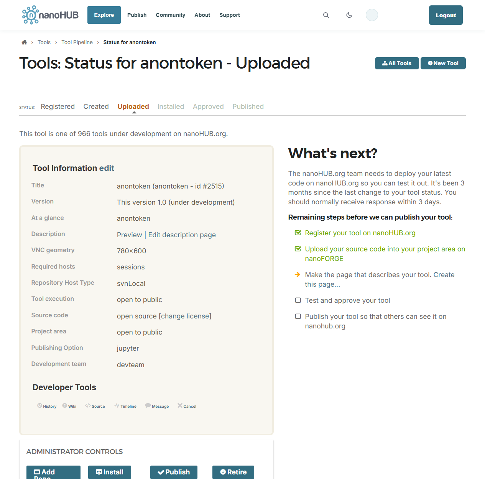

This is an admin task. On the tool's status page, press **Install** in
**Administrator Controls**. The CMS builds a command line and runs it as the
`apps` user:

- For an external Git repository it first mirrors the code with `git2git.sh`
  (or `git2svn.sh` on hubs that only have that).
- Then it runs `installtool.sh` — falling back to the older `installtool` —
  passing the repository host, the project alias, and the hub directory.

Both scripts are part of the tool platform, so what they do on disk could not
be verified here. The CMS shows their output: green for success, red with the
errors for failure.

The next step is on the execution host. Open a workspace and, in an xterm:

```
sudo su - apps
cd /apps/toolname/dev/src
make all
make install
```

If `sudo su - apps` fails, the account is not in the `apps` group — see
**Preparation**.

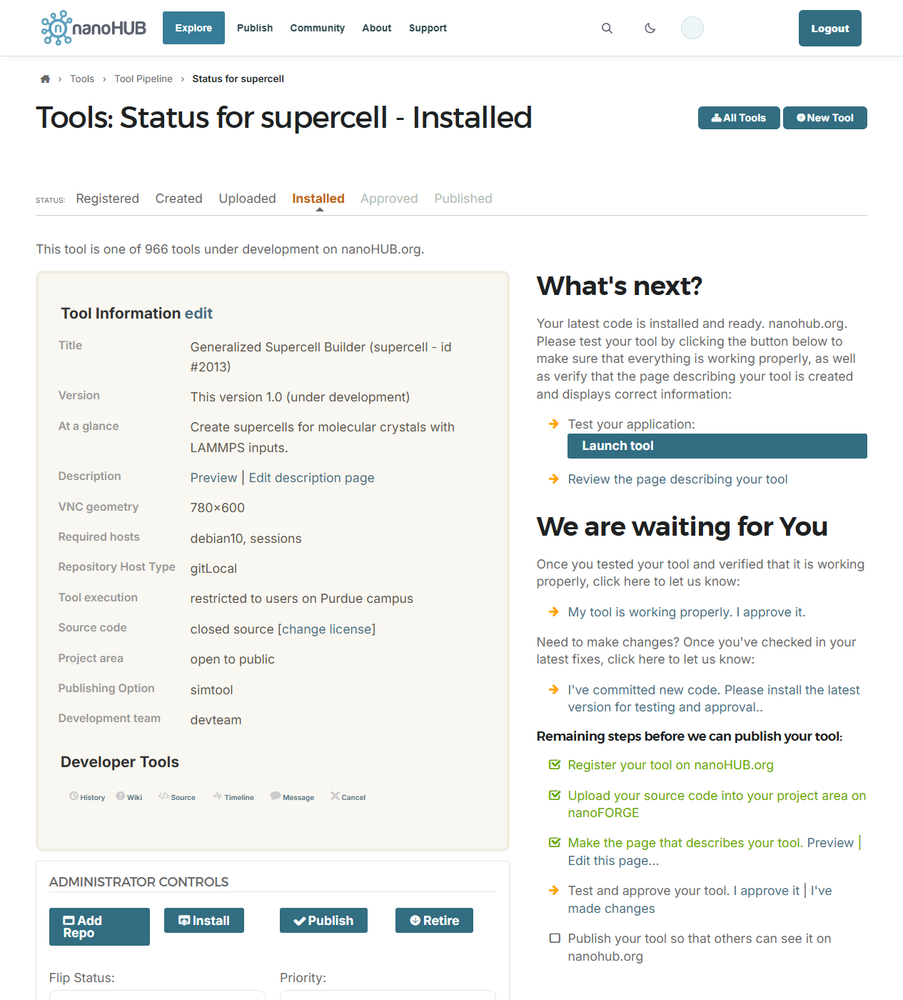

Back on the status page, set **Flip Status** to **Installed** and press
**Apply change**. The **What's next?** panel then offers a **Launch tool**
button. Use it and confirm the tool runs.

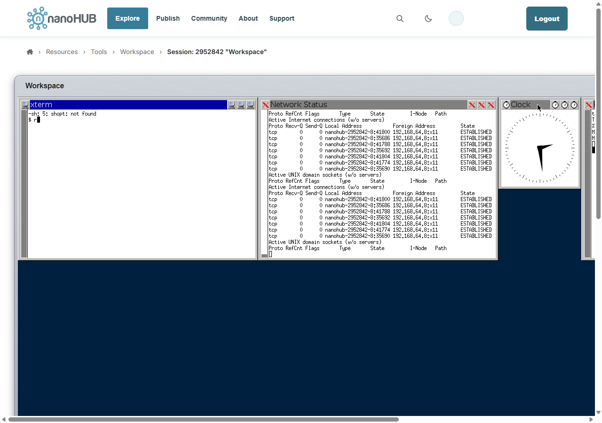

## Installed to Updated


Testing the tool is the developer's job. When they find something to fix, they
commit the change and use the **What's next?** link *"I've committed new code.
Please install the latest version for testing and approval."* That sets the
status to **Updated**, which is the pipeline's way of telling the
administrator to install again.

## Installed to Approved


Approval is a user task. Before a tool can be approved it needs a tool
information page — the resource page listing authors, credits, publications,
and screenshots. The **What's next?** panel links to it, as **Create this
page** or **Edit this page** depending on whether one exists.

The wizard collects and formats the information and ends on a preview the
developer confirms.

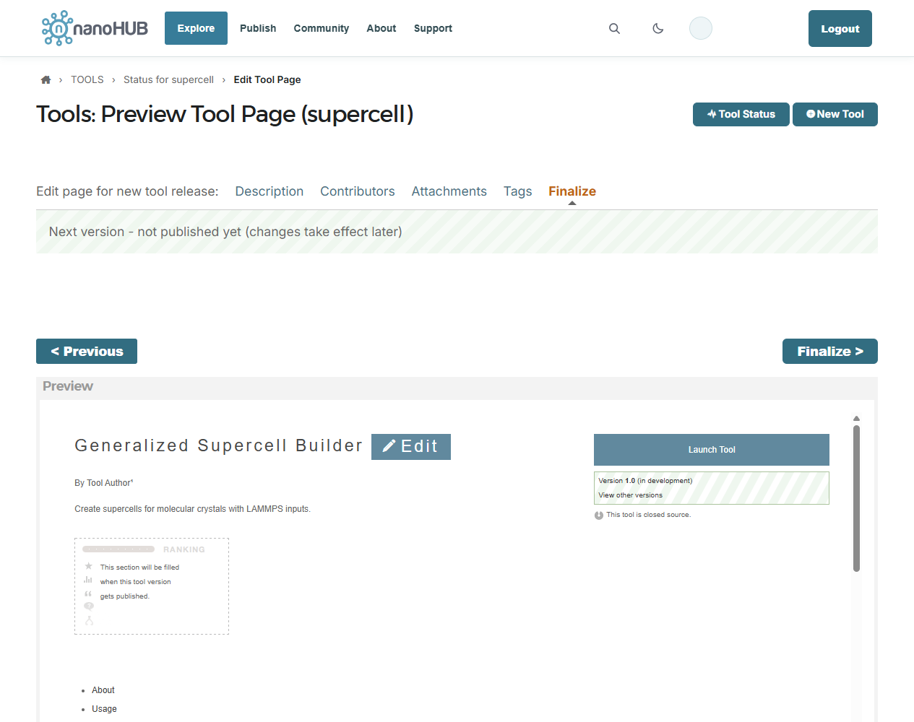

The developer also picks a license, replacing the template text with their
own. Closed source requires a reason.

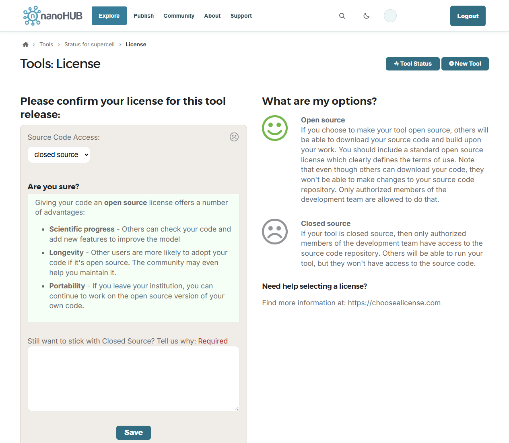

Finally, **Approve this tool**. The status changes to **Approved**.

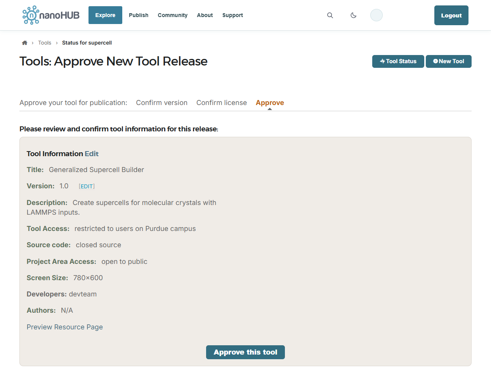

> **Note:** Moving to **Approved** goes through a version check first. If the
> version number on the tool is not a valid new version, the pipeline sends
> the developer to the versions form to confirm or set one before the flip
> takes effect.

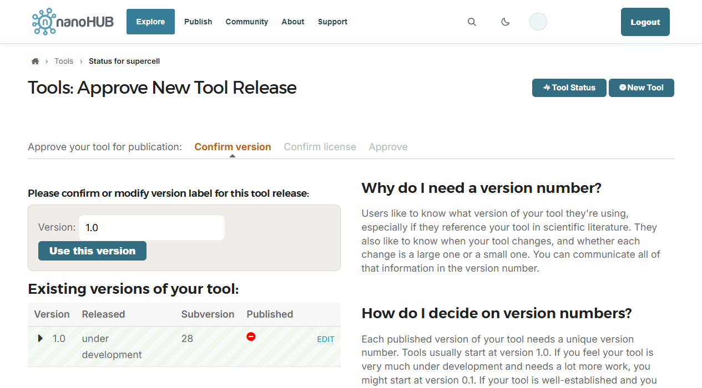

## Approved to Published


This is an admin task. Press **Publish** in **Administrator Controls**. The
publish process exposes the tool information page on the hub and its output
comes back the same way as **Install** — green for success, red for failure.
Then set **Flip Status** to **Published** and press **Apply change**, which
also sets the tool's published flag.

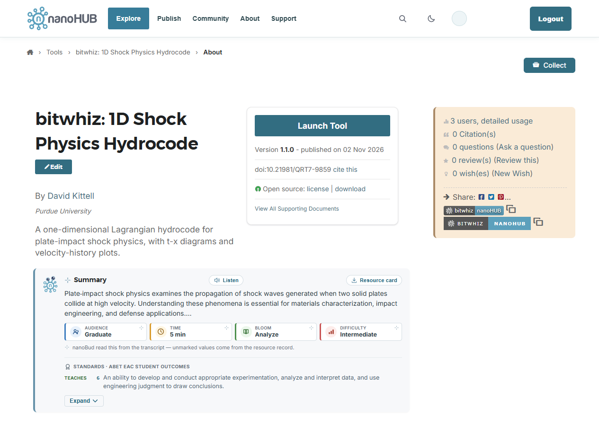

From the tool information page the tool can now be launched with **Launch
tool**.

## Published to Updated

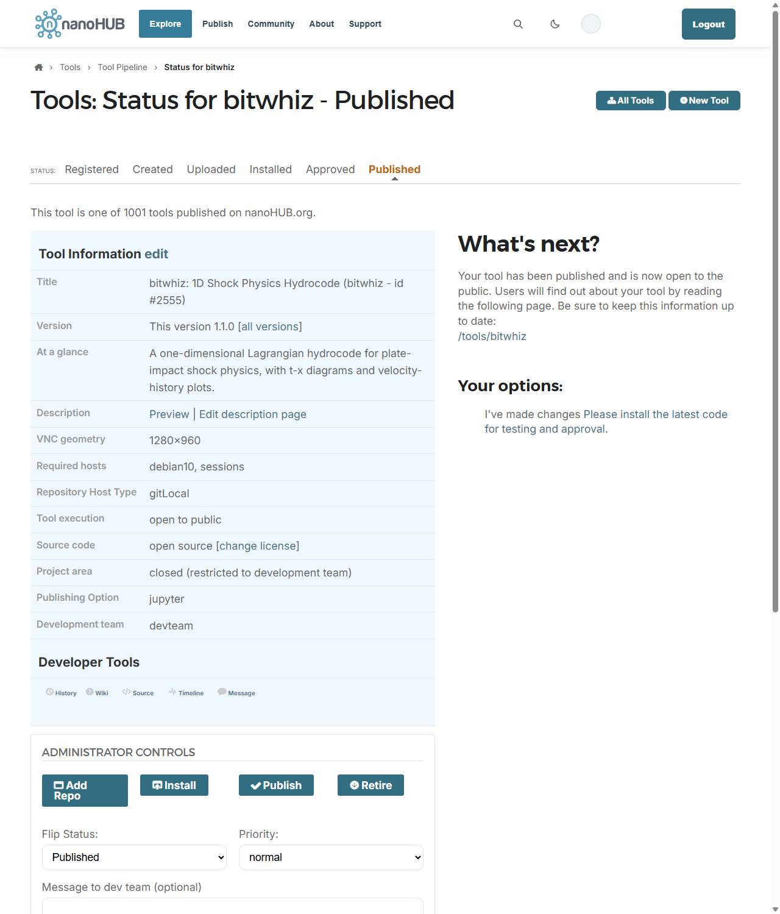

When the developer is ready to test a new release, they commit the changes and
use the **What's next?** link to move the status from **Published** to
**Updated**. This does not unpublish anything — the published version keeps
serving users. It signals that the development version needs reinstalling, and
the install–approve–publish cycle runs again.

## Published to Retired


Published tools usually stay published. Retiring one leaves the tool
information page in place as a record but stops anyone running it.

**Retired** is on the administrator's **Flip Status** drop-down only for tools
whose published flag is set, and there is a **Retire** button in
**Administrator Controls** alongside it. A retired tool's **What's next?**
panel offers the developer a link asking for it to be republished, which moves
it back to **Updated**.

## Cancelling a contribution

A developer can abandon a tool that has not been published. The **Cancel**
link under **Developer Tools** asks for confirmation, then unpublishes the
draft resource page, sets the tool's state to **Abandoned**, drops its
priority to lowest, and notes the cancellation on the tool's support ticket.
Cancelling a published tool is refused, as is cancelling one already
abandoned.
