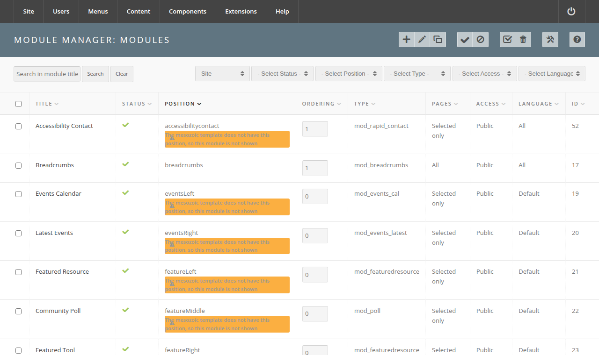
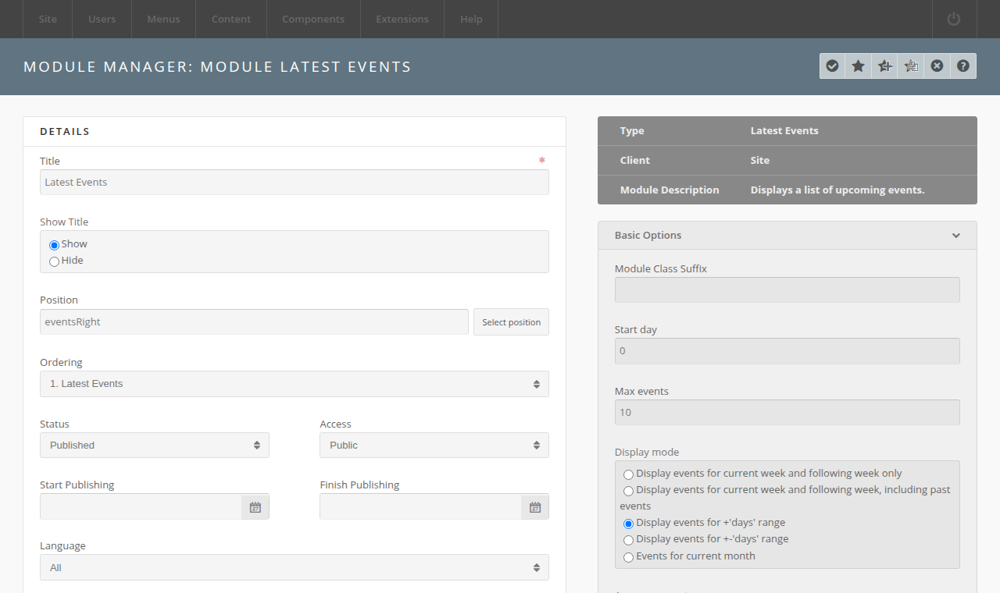

<!--
status: rewritten
reviewed-against: 2.4-main @ 35f103b1b3
reviewed: 2026-09-10
screenshots: ok
source: https://help.hubzero.org/documentation/240/managers/configuring/modules
-->
# Modules

Most modules carry parameters: what they show, how many items, which feed to
read. Parameters belong to one module *instance*, so the same module type
can appear twice on a hub with different settings.

That last point is the useful one. A hub can put the same list of newest
resources in the sidebar of the front page showing three items, and in the
footer showing ten, without touching any code — they are two instances of one
module, each with its own parameters. If a block on the site is showing the
wrong number of things, or the wrong kind of things, this is where you fix
it.

This chapter covers the parameters. Creating a module, choosing its position,
deciding which pages it appears on and putting it in order are covered in
[Module Manager](../10-extensions/01-modules.md) — the same screen, the other
half of the job.

> **Important:** If a module is not appearing at all, its parameters are
> almost never the reason. Check its position first: a module in a position
> the live template does not draw renders nothing, silently, however
> correctly it is configured. See
> [Positions](../10-extensions/01-modules.md#positions).

## Opening a module's parameters

1. Sign in to the administrator interface.
2. Choose **Extensions > Module Manager**.
3. Select the module's title in the list.
4. Find the collapsible panels on the right of the edit screen: **Basic
   Options**, and **Advanced Options** if the module declares any. A module
   that declares no parameters has no panels.
5. Change what you need and select **Save** or **Save & Close** in the
   toolbar. Changes take effect immediately.

> **Note:** Not every module has parameters. Those that do affect only that
> one instance.

Editing parameters is about as safe as this book gets. The change lands on
one block of one page, it is visible the moment you save, and setting the
value back undoes it. The one field in the **Details** column worth being
careful with is **Position**, because moving a module to a position no
template draws makes it vanish without an error.

## The list screen

The list is filtered by a search box and five drop-downs: **Client** (Site
or Administrator), **- Select Status -**, **- Select Position -**,
**- Select Type -**, **- Select Access -**, and **- Select Language -**.

Its columns are **Title**, **Status**, **Position**, **Ordering**, **Type**,
**Pages**, **Access**, **Language**, and **ID**. Select a column heading to
sort by it.

A module assigned to a position the default site template does not have is
flagged under its position with a warning that it is not shown. That is the
usual reason a module that is published and assigned to every page still
appears nowhere.

The toolbar offers **New**, **Edit**, **Duplicate**, **Publish**,
**Unpublish**, **Check In**, **Trash**, **Options**, and **Help**. Each
button appears only if your account holds the matching permission.
**New** opens a pop-up listing the module types you can add. Filtering the
list to the trash replaces **Trash** with **Empty trash**.

## The edit screen

The left column holds the module's **Details**: **Title**, **Show Title**,
**Position**, **Ordering**, **Status**, **Access**, **Start Publishing**,
**Finish Publishing**, **Language**, and **Note**. Custom HTML modules also
get a **Custom output** panel with a **Text** editor.

Site modules get a **Menu Assignment** section below that. **Module
Assignment** chooses between all pages, no pages, only the pages selected,
or all except the pages selected; the tree below it is where you pick them.
Administrator modules have no assignment section.

The right column holds the parameter panels and a table of facts about the
module — its type, whether it belongs to the site or the administrator, and
its ID.

The toolbar has **Save**, **Save & Close**, **Save & New**, **Save as
Copy**, **Cancel**, and **Help**. **Save** keeps you on the screen; **Save
& Close** returns to the list.

Every module's parameters are listed in the generated
[configuration reference](../../reference/configuration/README.md).

> **Tip:** The Module Manager also adds and removes modules, not just
> configures them. See [Modules manager](../10-extensions/01-modules.md).
