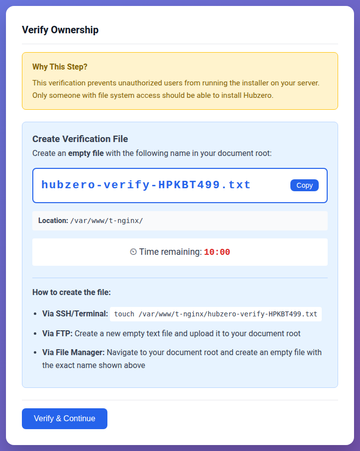
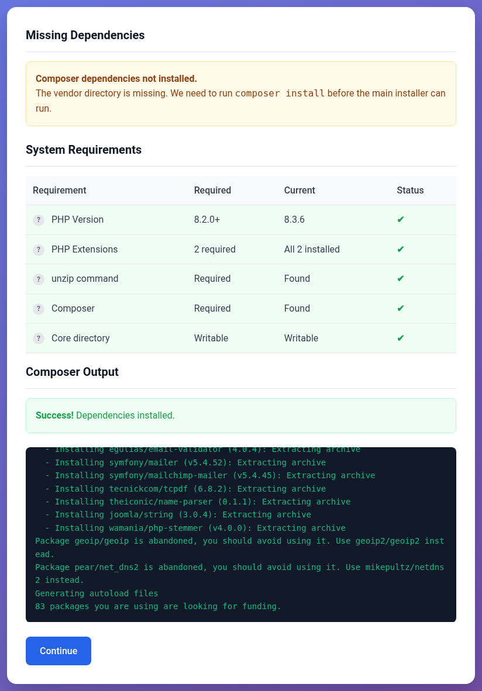
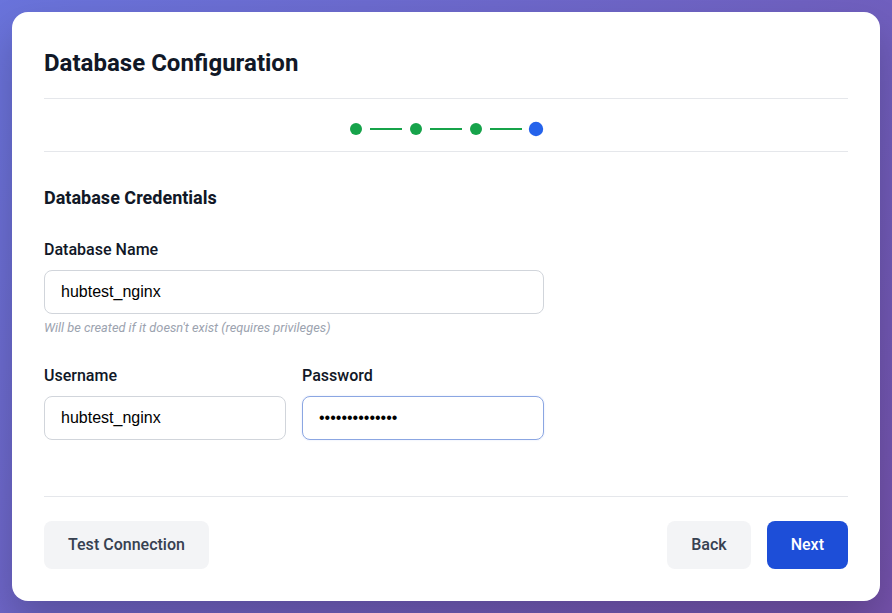
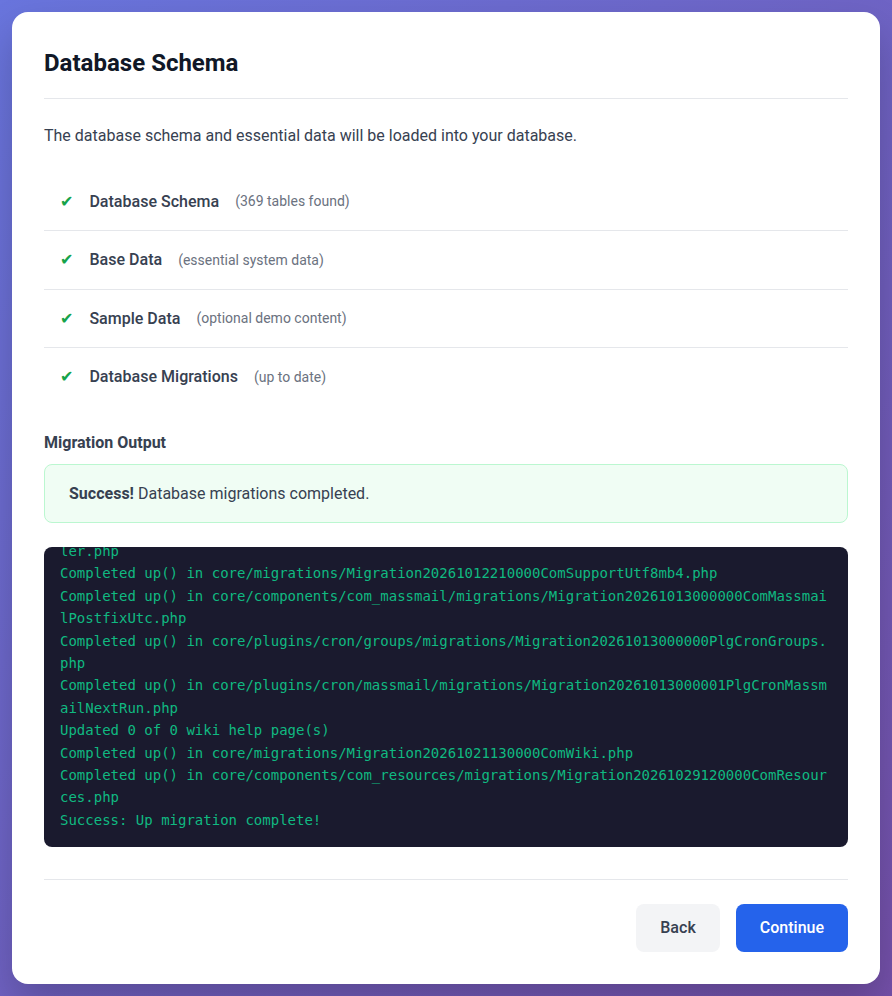
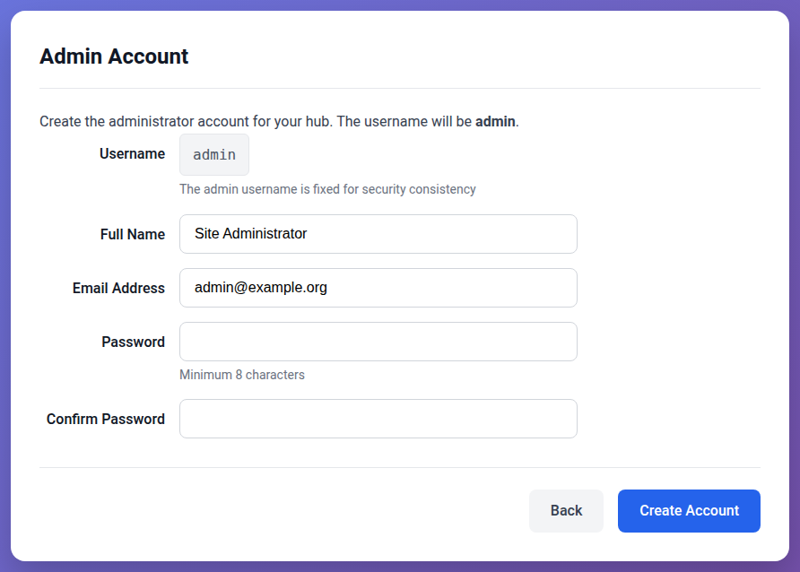

<!--
status: rewritten
reviewed-against: 2.4-main @ a89b23e433
reviewed: 2026-10-30
screenshots: ok
summary: Installing a hub on Debian, Ubuntu or Enterprise Linux with PHP 8.2 and MariaDB, behind Apache, nginx or FrankenPHP in Docker, using the browser installer or muse install.
-->
# Installing a hub

This page takes a Linux server with nothing on it to a hub that answers at
its own address and has an administrator who can sign in. It uses MariaDB for
the database and gives three ways to serve the hub: Apache with PHP-FPM, nginx
with PHP-FPM, or FrankenPHP in a Docker container. The installation itself can be run from the
browser or from the command line. Every combination gives the same hub, so
choose the web server you already know how to run, and whichever installer
suits you.

What it installs is the CMS. The parts of a hub that are not the CMS — the
tool session middleware, Workspaces, the mail gateway, LDAP and Solr — are
separate services, and none of them is needed for a hub to run. Search on
Solr is covered in [Search](../managers/09-components/31-search/README.md).

If the hub you are asking about is already installed and answering, this is
the wrong page. Go to
[The first week with a new hub](../managers/01-getting-started.md#the-first-week-with-a-new-hub),
which starts from a hub that runs and walks the decisions that come next in
order.

This branch is built for PHP 8.2, and the page installs that version on
every system it covers: Debian 12 and 13, Ubuntu 22.04, 24.04 and 26.04, and
Enterprise Linux 8, 9 and 10 (Red Hat Enterprise Linux, Rocky Linux,
AlmaLinux). Most of the page is the same everywhere; where a system differs,
it has a section of its own, even when that means saying something twice.

What was run, and where:

- **Full installs, browser and command line:** Ubuntu 24.04 behind Apache
  and nginx (with Ubuntu's PHP 8.3), and FrankenPHP's PHP 8.2 Docker image.
- **Full installs, command line:** Enterprise Linux 8 and 10 behind Apache,
  and 9 behind nginx, each with PHP 8.2 from the packages named below, in
  Rocky Linux containers. A container has no SELinux, firewall or systemd,
  so those steps are written from the distributions' documentation and were
  not run.
- **PHP 8.2 packages installed and every extension checked:** Debian 12 and
  13, Ubuntu 22.04 and 24.04.
- **Databases:** MariaDB 10.11 and 11.8.

## What you need

- A Linux server. Hubzero does not run on Windows; the installer refuses to
  start there.
- A name for the hub, such as `hub.example.org`, pointing at the server, and a
  TLS certificate for it. A hub has to be served over HTTPS: the administrator
  sign-in form always posts to an `https://` address, so on plain HTTP the
  administrator can never sign in.
- MariaDB, or MySQL.
- `unzip` and `git`. Composer itself ships in the repository as
  `core/bin/composer`; you do not install it separately.
- PHP, with the extensions the installer checks for.

The PHP version and extensions, read here from the installer's own
requirements check:

<!--include: core/libraries/Hubzero/System/Requirements.php:25-40-->

## 1. Install the packages

Find your system below. Each section installs the database, PHP 8.2 with
the extensions the hub needs, the tools, and then lets you choose Apache or
nginx. If you are going to run FrankenPHP in Docker instead, install only
the database and the tools from your system's section, then go to
[FrankenPHP in Docker](#frankenphp-in-docker-on-any-of-these-systems).

On every system, `json`, `openssl`, `fileinfo` and `pdo` come with PHP
itself. The XML package is not on the installer's list, but the libraries
Composer installs need it.

### Debian 12

PHP 8.2 and MariaDB 10.11 are Debian 12's own.

```bash
sudo apt install mariadb-server git unzip \
    php8.2-cli php8.2-fpm php8.2-mysql php8.2-mbstring php8.2-curl \
    php8.2-gd php8.2-zip php8.2-xml
```

Then the web server, one of:

```bash
sudo apt install apache2
sudo a2enmod proxy_fcgi setenvif ssl
```

```bash
sudo apt install nginx
```

### Debian 13

Debian 13 ships PHP 8.4. PHP 8.2 comes from Ondřej Surý's archive, which
packages it for Debian under the same names Debian uses:

```bash
sudo apt install curl ca-certificates lsb-release
curl -sSLo /tmp/debsuryorg-archive-keyring.deb https://packages.sury.org/debsuryorg-archive-keyring.deb
sudo dpkg -i /tmp/debsuryorg-archive-keyring.deb
echo "deb [signed-by=/usr/share/keyrings/debsuryorg-archive-keyring.gpg] https://packages.sury.org/php/ $(lsb_release -sc) main" \
    | sudo tee /etc/apt/sources.list.d/php.list
sudo apt update
```

Then the same packages as Debian 12. MariaDB is Debian 13's own, 11.8:

```bash
sudo apt install mariadb-server git unzip \
    php8.2-cli php8.2-fpm php8.2-mysql php8.2-mbstring php8.2-curl \
    php8.2-gd php8.2-zip php8.2-xml
```

Then the web server, one of:

```bash
sudo apt install apache2
sudo a2enmod proxy_fcgi setenvif ssl
```

```bash
sudo apt install nginx
```

### Ubuntu 22.04 and 24.04

Ubuntu 22.04 ships PHP 8.1 and 24.04 ships 8.3. PHP 8.2 comes from Ondřej
Surý's PPA:

```bash
sudo apt install software-properties-common
sudo add-apt-repository ppa:ondrej/php
sudo apt update
```

Then the packages. MariaDB is Ubuntu's own: 10.6 on 22.04, 10.11 on 24.04.

```bash
sudo apt install mariadb-server git unzip \
    php8.2-cli php8.2-fpm php8.2-mysql php8.2-mbstring php8.2-curl \
    php8.2-gd php8.2-zip php8.2-xml
```

Then the web server, one of:

```bash
sudo apt install apache2
sudo a2enmod proxy_fcgi setenvif ssl
```

```bash
sudo apt install nginx
```

### Ubuntu 26.04

Ubuntu 26.04 ships PHP 8.5, and the PPA above has no packages for it, so
there is no PHP 8.2 to install on the system itself. Run the hub in
FrankenPHP's PHP 8.2 Docker image instead. Install the database, the tools
and Docker:

```bash
sudo apt install mariadb-server git unzip docker.io
```

MariaDB is Ubuntu's own, 11.8. Then go to
[FrankenPHP in Docker](#frankenphp-in-docker-on-any-of-these-systems).

### Enterprise Linux 8

PHP 8.2 and MariaDB 10.11 are module streams in AppStream. Enable them
before installing anything from either:

```bash
sudo dnf module enable php:8.2 mariadb:10.11
sudo dnf install mariadb-server git unzip \
    php-cli php-fpm php-mysqlnd php-mbstring php-gd php-xml php-process php-pecl-zip
sudo systemctl enable --now mariadb php-fpm
```

`php-process` brings the POSIX functions the command line uses. `curl` and
`sockets` come with `php-cli`.

Then the web server, one of:

```bash
sudo dnf install httpd mod_ssl
sudo systemctl enable --now httpd
```

```bash
sudo dnf install nginx
sudo systemctl enable --now nginx
```

Then [the firewall and SELinux](#on-enterprise-linux-the-firewall-and-selinux).

### Enterprise Linux 9

The same as 8: PHP 8.2 and MariaDB 10.11 are module streams in AppStream.
Enable them first; without the MariaDB stream, `dnf` installs the default
10.5.

```bash
sudo dnf module enable php:8.2 mariadb:10.11
sudo dnf install mariadb-server git unzip \
    php-cli php-fpm php-mysqlnd php-mbstring php-gd php-xml php-process php-pecl-zip
sudo systemctl enable --now mariadb php-fpm
```

Then the web server, one of:

```bash
sudo dnf install httpd mod_ssl
sudo systemctl enable --now httpd
```

```bash
sudo dnf install nginx
sudo systemctl enable --now nginx
```

Then [the firewall and SELinux](#on-enterprise-linux-the-firewall-and-selinux).

### Enterprise Linux 10

Enterprise Linux 10 has no module streams for PHP, and AppStream has PHP
8.3. PHP 8.2 comes from Remi Collet's repository, which needs EPEL:

```bash
sudo dnf install epel-release
sudo dnf install https://rpms.remirepo.net/enterprise/remi-release-10.rpm
sudo dnf module enable php:remi-8.2
```

On Red Hat Enterprise Linux itself, where `epel-release` is not in the
repositories, install it from
`https://dl.fedoraproject.org/pub/epel/epel-release-latest-10.noarch.rpm`
instead.

Then the packages. MariaDB is AppStream's own, 10.11:

```bash
sudo dnf install mariadb-server git unzip \
    php-cli php-fpm php-mysqlnd php-mbstring php-gd php-xml php-process php-pecl-zip
sudo systemctl enable --now mariadb php-fpm
```

Then the web server, one of:

```bash
sudo dnf install httpd mod_ssl
sudo systemctl enable --now httpd
```

```bash
sudo dnf install nginx
sudo systemctl enable --now nginx
```

Then [the firewall and SELinux](#on-enterprise-linux-the-firewall-and-selinux).

### On Enterprise Linux: the firewall and SELinux

Enterprise Linux starts with the firewall closed and SELinux enforcing.
Open the web ports:

```bash
sudo firewall-cmd --permanent --add-service=http --add-service=https
sudo firewall-cmd --reload
```

SELinux lets the web server read files under `/var/www` but not write
them, and not open network connections. The hub writes to its own
directory, and the installer writes to the whole of it; it connects to
MariaDB over TCP, and the browser installer downloads Composer's libraries.
Once the code is in place in step 3:

```bash
sudo dnf install policycoreutils-python-utils
sudo semanage fcontext -a -t httpd_sys_rw_content_t "/var/www/hub(/.*)?"
sudo restorecon -R /var/www/hub
sudo setsebool -P httpd_can_network_connect_db 1
sudo setsebool -P httpd_can_network_connect 1
sudo setsebool -P httpd_can_sendmail 1
```

These were not run: the test installs were in containers, which have no
SELinux. If something the web server does fails with a permission error
that the file permissions do not explain, `sudo ausearch -m avc -ts recent`
shows what SELinux refused. The command-line installer does its work as a
login user rather than through the web server, so it is the safer of the
two on a system where SELinux has not been set up for the hub yet.

### FrankenPHP in Docker, on any of these systems

Install the database and the tools from your system's section above, but
not PHP or a web server: the image brings PHP, and FrankenPHP is the web
server. Then Docker:

- **Debian and Ubuntu:** `sudo apt install docker.io`.
- **Enterprise Linux 8, 9 and 10:** from Docker's own repository. It
  replaces Podman, which Enterprise Linux installs by default:

  ```bash
  sudo dnf remove podman buildah runc
  sudo dnf install dnf-plugins-core
  sudo dnf config-manager --add-repo https://download.docker.com/linux/rhel/docker-ce.repo
  sudo dnf install docker-ce docker-ce-cli containerd.io
  sudo systemctl enable --now docker
  ```

  Open the firewall as in
  [the firewall and SELinux](#on-enterprise-linux-the-firewall-and-selinux);
  the SELinux settings there are for Apache and nginx and do not apply.

The image itself is built in step 4.

## 2. Create the database

Hubzero needs a database and an account that owns it. MariaDB's `root`
account signs in through the operating system rather than with a password,
so create them with `sudo`:

```bash
sudo mariadb
```

```sql
CREATE DATABASE hub CHARACTER SET utf8mb4 COLLATE utf8mb4_unicode_ci;
CREATE USER 'hub'@'localhost' IDENTIFIED BY 'a-long-random-password';
GRANT ALL PRIVILEGES ON hub.* TO 'hub'@'localhost';
```

The usage statistics keep a second database of their own, named after the
first with `_metrics` on the end. A hub runs without it, but its usage pages
stay empty. If you want them, create it now as well:

```sql
CREATE DATABASE hub_metrics CHARACTER SET utf8mb4 COLLATE utf8mb4_unicode_ci;
GRANT ALL PRIVILEGES ON hub_metrics.* TO 'hub'@'localhost';
```

On Enterprise Linux, MariaDB was started in step 1. On Debian and Ubuntu
the package starts it. On every system above, MariaDB's `root` signs in with
`sudo mariadb` and no password.

The browser installer can also create the database and account itself, if you
give it an administrator account that has a password and the right to grant
privileges. Creating them by hand, as above, needs neither.

## 3. Get the code

The repository is the hub: its top directory is the web server's document
root. Clone it:

```bash
sudo git clone --branch 2.4-main https://github.com/hubzero/hubzero-cms.git /var/www/hub
```

Then give it to the account that runs PHP:

- **Debian and Ubuntu, with Apache or nginx:** `www-data`.

  ```bash
  sudo chown -R www-data:www-data /var/www/hub
  ```

- **Enterprise Linux, with Apache or nginx:** `apache`. PHP-FPM's pool runs
  as `apache` with either web server.

  ```bash
  sudo chown -R apache:apache /var/www/hub
  ```

- **FrankenPHP in Docker, on any system:** user and group 33, which is
  `www-data` inside the image. On Debian and Ubuntu that is `www-data` on
  the server too; on Enterprise Linux no account has the number, so use it
  as it is.

  ```bash
  sudo chown -R 33:33 /var/www/hub
  ```

The rest of this page writes `www-data` in commands such as
`sudo -u www-data ...`. On Enterprise Linux with Apache or nginx, write
`apache`.

On Enterprise Linux with Apache or nginx, now set the SELinux labels in
[the firewall and SELinux](#on-enterprise-linux-the-firewall-and-selinux).

The installer writes the hub's configuration into a new `app/` directory
inside it, and the hub later keeps its uploads, logs and cache there, so the
web server's account has to be able to write to the whole tree. Run every
command that changes the hub as that account (`sudo -u www-data ...`, or in
the container with FrankenPHP), so nothing ends up owned by someone the web
server cannot write as.

## 4. Configure the web server

Each configuration below does the same four things:

- serves `/var/www/hub` as the document root, over HTTPS;
- passes PHP files to PHP;
- sends every address that is not a file to `index.php`, which is how the
  hub's addresses work;
- refuses requests for the hub's configuration, logs, temporary files,
  command-line programs and hidden files.

The last of those matters: `app/config/database.php` holds the database
password, and nothing else stops a browser from reading it.

Replace `hub.example.org` and the certificate paths with your own. The
examples use certificates from Let's Encrypt's `certbot`: on Debian and
Ubuntu `sudo apt install certbot`, on Enterprise Linux
`sudo dnf install certbot` from EPEL.

### Apache with PHP-FPM on Debian and Ubuntu

`/etc/apache2/sites-available/hub.conf`:

```apache
<VirtualHost *:80>
    ServerName hub.example.org
    Redirect permanent / https://hub.example.org/
</VirtualHost>

<VirtualHost *:443>
    ServerName hub.example.org
    DocumentRoot /var/www/hub

    SSLEngine on
    SSLCertificateFile    /etc/letsencrypt/live/hub.example.org/fullchain.pem
    SSLCertificateKeyFile /etc/letsencrypt/live/hub.example.org/privkey.pem

    <Directory /var/www/hub>
        Options -Indexes +FollowSymLinks
        AllowOverride None
        Require all granted
        FallbackResource /index.php
    </Directory>

    <FilesMatch "\.php$">
        SetHandler "proxy:unix:/run/php/php8.2-fpm.sock|fcgi://localhost"
    </FilesMatch>

    <LocationMatch "^/(app/(config|logs|tmp)|core/(bin|vendor/bin))(/|$)">
        Require all denied
    </LocationMatch>
    <LocationMatch "/\.(?!well-known)">
        Require all denied
    </LocationMatch>

    ErrorLog ${APACHE_LOG_DIR}/hub-error.log
    CustomLog ${APACHE_LOG_DIR}/hub-access.log combined
</VirtualHost>
```

```bash
sudo a2ensite hub
sudo apache2ctl configtest && sudo systemctl reload apache2
```

The repository has no `.htaccess` file. Everything the hub needs is in this
block, so `AllowOverride None` is right, and `FallbackResource` does the work
a rewrite rule would.

### Apache with PHP-FPM on Enterprise Linux

The same configuration, with Enterprise Linux's paths: the file goes in
`/etc/httpd/conf.d/`, PHP-FPM listens on `/run/php-fpm/www.sock`, and logs
are relative to `/var/log/httpd`. `mod_ssl` already listens on port 443.
`/etc/httpd/conf.d/hub.conf`:

```apache
<VirtualHost *:80>
    ServerName hub.example.org
    Redirect permanent / https://hub.example.org/
</VirtualHost>

<VirtualHost *:443>
    ServerName hub.example.org
    DocumentRoot /var/www/hub

    SSLEngine on
    SSLCertificateFile    /etc/letsencrypt/live/hub.example.org/fullchain.pem
    SSLCertificateKeyFile /etc/letsencrypt/live/hub.example.org/privkey.pem

    <Directory /var/www/hub>
        Options -Indexes +FollowSymLinks
        AllowOverride None
        Require all granted
        FallbackResource /index.php
    </Directory>

    <FilesMatch "\.php$">
        SetHandler "proxy:unix:/run/php-fpm/www.sock|fcgi://localhost"
    </FilesMatch>

    <LocationMatch "^/(app/(config|logs|tmp)|core/(bin|vendor/bin))(/|$)">
        Require all denied
    </LocationMatch>
    <LocationMatch "/\.(?!well-known)">
        Require all denied
    </LocationMatch>

    ErrorLog logs/hub-error.log
    CustomLog logs/hub-access.log combined
</VirtualHost>
```

```bash
sudo apachectl configtest && sudo systemctl reload httpd
```

### nginx with PHP-FPM on Debian and Ubuntu

`/etc/nginx/sites-available/hub`:

```nginx
server {
    listen 80;
    server_name hub.example.org;
    return 301 https://$host$request_uri;
}

server {
    listen 443 ssl;
    server_name hub.example.org;
    root /var/www/hub;
    index index.php;

    ssl_certificate     /etc/letsencrypt/live/hub.example.org/fullchain.pem;
    ssl_certificate_key /etc/letsencrypt/live/hub.example.org/privkey.pem;

    client_max_body_size 100m;

    location ~ ^/(app/(config|logs|tmp)|core/(bin|vendor/bin))(/|$) { deny all; }
    location ~ /\.(?!well-known) { deny all; }

    location / {
        try_files $uri $uri/ /index.php?$query_string;
    }

    # Addresses such as /administrator/index.php name no file; the hub's own
    # index.php answers them, as it does every other address
    location ~ \.php$ {
        try_files $uri /index.php?$query_string;
        include fastcgi_params;
        fastcgi_param SCRIPT_FILENAME $document_root$fastcgi_script_name;
        fastcgi_pass unix:/run/php/php8.2-fpm.sock;
        fastcgi_read_timeout 300;
    }
}
```

```bash
sudo ln -s /etc/nginx/sites-available/hub /etc/nginx/sites-enabled/hub
sudo nginx -t && sudo systemctl reload nginx
```

Do not use Ubuntu's `snippets/fastcgi-php.conf` for this block. It answers
404 for any `.php` address that is not a file, and the administrator
interface lives at one: `/administrator/index.php` is answered by the hub's
`index.php`, not by a file of that name. Raise `client_max_body_size` if
members will upload files larger than 100 MB.

### nginx with PHP-FPM on Enterprise Linux

The same configuration, with Enterprise Linux's paths: the file goes in
`/etc/nginx/conf.d/`, which nginx reads without a link, and PHP-FPM listens
on `/run/php-fpm/www.sock`. PHP-FPM's pool already lets nginx use the socket.
`/etc/nginx/conf.d/hub.conf`:

```nginx
server {
    listen 80;
    server_name hub.example.org;
    return 301 https://$host$request_uri;
}

server {
    listen 443 ssl;
    server_name hub.example.org;
    root /var/www/hub;
    index index.php;

    ssl_certificate     /etc/letsencrypt/live/hub.example.org/fullchain.pem;
    ssl_certificate_key /etc/letsencrypt/live/hub.example.org/privkey.pem;

    client_max_body_size 100m;

    location ~ ^/(app/(config|logs|tmp)|core/(bin|vendor/bin))(/|$) { deny all; }
    location ~ /\.(?!well-known) { deny all; }

    location / {
        try_files $uri $uri/ /index.php?$query_string;
    }

    # Addresses such as /administrator/index.php name no file; the hub's own
    # index.php answers them, as it does every other address
    location ~ \.php$ {
        try_files $uri /index.php?$query_string;
        include fastcgi_params;
        fastcgi_param SCRIPT_FILENAME $document_root$fastcgi_script_name;
        fastcgi_pass unix:/run/php-fpm/www.sock;
        fastcgi_read_timeout 300;
    }
}
```

```bash
sudo nginx -t && sudo systemctl reload nginx
```

The stock `/etc/nginx/nginx.conf` also has a server on port 80 for any
other name. It does not get in the way, but you can delete it.

### FrankenPHP in Docker

Build an image from FrankenPHP's PHP 8.2 image with the extensions the hub
needs that it does not already have. Put this in
`/opt/hub-frankenphp/Dockerfile`:

```dockerfile
FROM dunglas/frankenphp:1-php8.2-bookworm

# The extensions the hub needs that the image does not already have, and the
# tools Composer uses
RUN install-php-extensions pdo_mysql gd zip sockets opcache \
    && apt-get update \
    && apt-get install -y --no-install-recommends git unzip \
    && rm -rf /var/lib/apt/lists/*

# PHP's production settings, and a place for sessions outside the document
# root: the image has neither, and the installer keeps its secrets there
RUN cp "$PHP_INI_DIR/php.ini-production" "$PHP_INI_DIR/php.ini" \
    && mkdir -p /var/lib/php/sessions \
    && chown www-data:www-data /var/lib/php/sessions \
    && echo 'session.save_path = "/var/lib/php/sessions"' > "$PHP_INI_DIR/conf.d/hub.ini"

# Run as the account that owns the hub's files, still able to listen on 80/443
RUN setcap CAP_NET_BIND_SERVICE=+eip /usr/local/bin/frankenphp \
    && chown -R www-data:www-data /config/caddy /data/caddy

USER www-data
```

```bash
sudo docker build -t hub-frankenphp /opt/hub-frankenphp
```

The session directory is not optional. Without a writable place outside the
document root, the installer stops at a page headed *Server Configuration
Required* before it asks anything.

FrankenPHP reads a Caddyfile. Put the hub's in
`/opt/hub-frankenphp/Caddyfile`:

```caddyfile
{
	frankenphp
	order php_server before file_server
}

hub.example.org {
	root * /var/www/hub

	@private path_regexp ^/(app/(config|logs|tmp)|core/(bin|vendor/bin))(/|$)
	@dotfiles {
		path_regexp /\.
		not path /.well-known/*
	}
	respond @private 403
	respond @dotfiles 403

	php_server
}
```

Then start the container:

```bash
sudo docker run -d --name hub --restart unless-stopped --network host \
    -v /var/www/hub:/var/www/hub \
    -v /opt/hub-frankenphp/Caddyfile:/etc/frankenphp/Caddyfile:ro \
    -v hub_caddy_data:/data -v hub_caddy_config:/config \
    hub-frankenphp
```

- `--network host` lets it answer on the server's own ports 80 and 443, and
  reach MariaDB at `127.0.0.1` as if it were not in a container.
- The hub's directory is mounted at the same path inside, so paths the
  installer writes into the configuration are right on both sides. The
  container runs as user 33, its `www-data`, which owns the files after
  step 3.
- `hub_caddy_data` keeps the certificates FrankenPHP obtains across restarts
  and rebuilds.
- On Enterprise Linux, where SELinux keeps containers out of files it has
  not labelled for them, write the hub's mount as
  `-v /var/www/hub:/var/www/hub:z`. Docker relabels the directory for
  containers when it starts.

FrankenPHP obtains and renews the certificate for `hub.example.org` itself,
so there are no certificate paths to give it. Its regular expressions have no
lookahead, which is why the hidden-file rule is a matcher of two lines rather
than the single pattern Apache and nginx use.

MariaDB's socket is not inside the container. When an installer asks how to
reach the database, choose `127.0.0.1` rather than the socket. The account
created above accepts either.

Every `php` command on this page runs inside the container with this in front
of it, and needs `-it` when it asks questions:

```bash
sudo docker exec -it -w /var/www/hub hub php core/bin/muse install
```

## 5. Install

Two installers do the same job: one in the browser, one on the command line.
Both load the database, write the configuration into `app/config/`, bring the
database up to date and create the administrator.

### From the command line

```bash
cd /var/www/hub
sudo -u www-data php core/bin/muse install
```

With FrankenPHP, run it in the container, as above.

`muse install` asks its questions one at a time and checks each answer before
moving on. In order:

1. **Composer.** If the libraries are not installed yet, it installs them
   first, which takes a minute or two. A warning that Composer *"Cannot create
   cache directory"* is harmless: `www-data` has no home of its own to keep
   a cache in, so Composer downloads without one.
2. **Requirements.** The PHP version, each extension, `unzip`, and whether it
   can write to the hub's directory. It lists every check, and stops if any of
   them failed.
3. **Site settings.** The hub's name, the administrator's email address, the
   address it is served at (`https://hub.example.org`), the time zone, and a
   description for search engines.
4. **Database.** It looks for an account it can use without asking, then
   offers to use an existing account or to create one with an
   administrator's credentials. Choose the existing account and give it the
   database, user and password from step 2.
5. **Schema.** It creates about 380 tables and loads the data every hub
   needs, then offers **sample data**: a front page, menus and articles to
   look at. Answer no for a hub you are going to fill yourself.
6. **Migrations.** It brings the database up to date, which takes a minute or
   so. Four warnings are expected; see
   [Warnings during the migrations](#warnings-during-the-migrations).
7. **Administrator.** A name, a username, an email address and a password of
   at least eight characters.

It ends by printing the site's address and the administrator's username.

### From the command line, without questions

`muse install` can take every answer from a file instead of asking for them,
which is how to install a hub from a script, or the same hub more than once.
The file is JSON:

```json
{
    "site": {
        "sitename": "My Hub",
        "mailfrom": "admin@hub.example.org",
        "live_site": "https://hub.example.org",
        "offset": "America/New_York"
    },
    "database": {
        "host": "127.0.0.1",
        "database": "hub",
        "username": "hub",
        "password": "a-long-random-password"
    },
    "admin": {
        "name": "Ada Administrator",
        "username": "admin",
        "email": "admin@hub.example.org",
        "password": "another-long-password"
    },
    "sample": false
}
```

| Section | Keys |
|---|---|
| `site` | `sitename`, `mailfrom` (the administrator's address), `live_site` (the hub's address; leave it out to have the hub work it out from each request), `offset` (a time zone such as `UTC` or `Europe/London`), and optionally `MetaDesc`, the description for search engines |
| `database` | `host`, `database`, `username`, `password`, and optionally `port`, `socket` and `prefix` (the table prefix, `jos_` unless you say otherwise) |
| `admin` | `name`, `username`, `email`, `password` (at least eight characters) |
| `sample` | `true` to load the sample data, `false` not to |

```bash
sudo -u www-data php core/bin/muse install --config=/var/www/hub-install.json
```

It runs every step the questions would, Composer included on a fresh
checkout, and stops at the first answer it cannot use, saying which. It never
creates the database or its account: create those first, as in step 2. Any
single step takes the file too, so one can be repeated on its own, for
example `muse install admin --config=...`.

The file holds two passwords. Keep it outside the hub's directory, where only
the hub's account can read it, and delete it once the hub is installed:

```bash
sudo chown www-data /var/www/hub-install.json && sudo chmod 600 /var/www/hub-install.json
```

With FrankenPHP, the file has to be inside the container:

```bash
sudo docker cp /var/www/hub-install.json hub:/tmp/hub-install.json
sudo docker exec -u root hub chown www-data /tmp/hub-install.json
sudo docker exec -w /var/www/hub hub php core/bin/muse install --config=/tmp/hub-install.json
sudo docker exec -u root hub rm /tmp/hub-install.json
```

### From the browser

Open `https://hub.example.org/`. A hub that is not installed yet answers every
address with its installer.

The first thing it asks is that you prove you can change files on the server,
so that nobody who merely finds the address can install a hub on it. It shows
the name of a file to create in the hub's directory:



Create it as the account that owns the hub, within ten minutes, then select
**Verify & Continue**:

```bash
sudo -u www-data touch /var/www/hub/hubzero-verify-XXXXXXXX.txt
```

The installer removes the file once it has seen it.

If the libraries are not installed yet, the next page is **Hubzero Bootstrap
Setup**. It checks what Composer needs and has a **Run Composer** button,
which installs the libraries and shows Composer's output as it goes. When it
reports **Success!**, select **Continue**.



The installation wizard follows. It moves through **Verify**, **Welcome**,
**Requirements**, **Database**, **Settings**, **Schema**, **Admin** and
**Complete**, and goes straight to the first step that still needs doing, so
after the bootstrap page it usually opens at **Database**.

**Database.** Choose how to reach MariaDB: **Standard (localhost)** connects
to `127.0.0.1` over TCP; **Unix Socket** uses MariaDB's socket file. Then
choose **I have credentials ready** and give it the database name, user and
password from step 2. **Test Connection** checks them without moving on.



**Settings.** The hub's name, the administrator's email address, the time
zone, and a description for search engines. Leave **Site URL** blank to have
the hub work out its address from each request, or give it, which
`muse cron:jobs tick` needs later.

**Schema.** Tick **Load sample data** if you want a front page, menus and
articles to look at, then select **Load Database**. It creates the tables,
loads the data and runs the migrations, showing their output as they go. This
takes a minute or two; leave the page open until it says **Success!**, then
select **Continue**.



**Admin.** The administrator's username is always `admin`. Give a name, an
email address and a password of at least eight characters, then select
**Create Account**. **Complete** follows, with the address of the
administrator interface.



Once the hub is installed, the installer refuses to change anything.
`/install` still answers, behind the same ownership check, but every step is
read-only.

## 6. After installing

**The welcome page.** Until you say otherwise, every page of the new hub shows
a welcome page that points at this documentation. Select **Jump to Your Hub**
on it to switch the hub to its real template. With sample data, that takes
you to a Getting Started article; without it, to the hub's front page.

**Sign in.** The administrator interface is at
`https://hub.example.org/administrator`. The same account signs in to the
site at `/login`.

**Scheduled tasks.** Nothing that runs on a schedule happens until the server
ticks the hub every minute. Add the cron entry described in
[Scheduled tasks](../managers/03-maintenance/05-cron.md#how-it-works). It needs the
hub's address in `live_site` in `app/config/app.php`. The browser installer
leaves that blank unless you filled in **Site URL**. With FrankenPHP the
entry runs `muse` in the container:
`sudo docker exec -w /var/www/hub hub php core/bin/muse cron:jobs tick`.

**Mail.** The hub sends mail with PHP's `mail()` until you configure
something else. See [Mail Settings](../managers/05-configuring/01-hub.md#mail-settings).

**Time zones in the database.** MariaDB on Ubuntu starts without its time
zone tables. The migrations load them only when they are run by the system's
`root`, which the installers are not. Load them once yourself:

```bash
mariadb-tzinfo-to-sql /usr/share/zoneinfo | sudo mariadb mysql
```

**Usage statistics.** If you created the `_metrics` database after
installing, run the migrations again to set it up. Only the ones that did
not finish run again:

```bash
cd /var/www/hub
sudo -u www-data php core/bin/muse migration run -f
```

**Keeping it up to date.** [Upgrading a hub](02-upgrading.md)
brings the hub up to the latest code on its branch, with a backup first and a
way back.

Then go on to
[The first week with a new hub](../managers/01-getting-started.md#the-first-week-with-a-new-hub).

## Warnings during the migrations

Both installers show the same four warnings on a new hub. None of them stops
the hub working:

| Warning | Why |
|---|---|
| *onBeforeMigrate hook 'UpdateTimezoneDatabase.php' ... Insufficient privileges to update timezone tables* | Loading MariaDB's time zone tables needs its `root` account. Load them yourself, as described above |
| *Migration20150330124145Core.php: Unable to write out new configuration file* | It updates a configuration file from an older version of the hub, which a new hub does not have |
| *Migration20150904235936ComUsage.php: Failed to run with the necessary privileges* | The `_metrics` database does not exist, and creating one needs `root`. Create it as in step 2 and run the migrations again |
| *Migration20170627153900ComHubgraph.php: Failed to run with the necessary privileges* | It removes database triggers that older hubs had. A new hub has none to remove |

A migration that ended in a warning is tried again the next time the
migrations run; one that succeeded is not.

Under FrankenPHP, the browser installer's migration output also carries
warnings that session settings *"cannot be changed after headers have
already been sent"*. They come from FrankenPHP's own command line, which the
installer runs the migrations with, and are harmless.

## When something goes wrong

**The administrator sign-in page does nothing, or the browser shows a
connection error after signing in.** The hub is being served over plain HTTP.
The administrator sign-in form posts to `https://`; serve the hub over HTTPS.

**`/administrator` answers 404 under nginx.** The PHP block is passing every
`.php` address straight to PHP, or uses Ubuntu's `fastcgi-php.conf`. Use the
block above, which hands addresses that are not files to `index.php`.

**A page says the file or directory is not writable, or images and uploads
fail.** Something in `/var/www/hub` belongs to an account the web server does
not run as, usually because a command was run as yourself or as `root`. Run
`sudo chown -R www-data:www-data /var/www/hub` again.

**The browser installer's migrations stop with *Connection error*.** The
migrations may still have finished. Reload the page; if it still lists
migrations as pending, finish them from the command line with
`sudo -u www-data php core/bin/muse migration run -f`.

**Under FrankenPHP, the installer cannot connect to the database through
the socket.** Use `127.0.0.1`, as described under
[FrankenPHP in Docker](#frankenphp-in-docker).

**Under FrankenPHP, the installer shows *Server Configuration Required*.**
PHP in the container has no writable place outside the document root. The
image was built without the `session.save_path` lines above; add them and
rebuild.

**Requests for `/app/config/database.php` do not answer 403.** The web
server's rules for private paths are missing. Check before the hub is in use:

```bash
curl -s -o /dev/null -w "%{http_code}\n" https://hub.example.org/app/config/database.php
```
