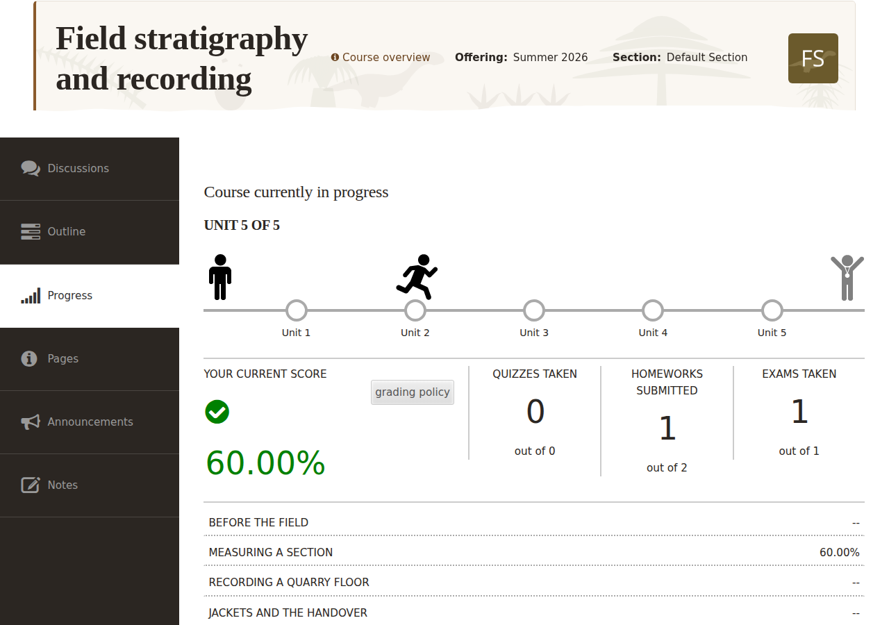

<!--
status: rewritten
reviewed-against: 2.4-main @ 42a7a5b5c7
reviewed: 2026-09-10
screenshots: ok
-->
# Student features

Finding a course, enrolling in it, working through it, and seeing how far you
have got. If you were sent a link by an instructor, start at
[Enrolling](#enrolling).

## Finding a course

1. Go to `https://yourhub.org/courses`.
2. Search from the box on that page, or select **Browse the catalog** for the
   full list.
3. The catalog sorts by **Title**, **Alias** or **Popularity**, and narrows to
   one tag at a time. Each entry shows the course number, its short
   description and its instructors.
4. Select a course title to open its overview.

## Enrolling

Enrolling is what turns a catalogue entry into your course. Until you do it
the hub is not tracking you: no progress, no grades, no certificate, and no
access to anything but the overview page.

The course overview is public. The long description, the instructors, the
course length and the estimated effort are all readable before you enrol.
Everything under **Go to Course** — the outline, discussions, your progress —
needs enrolment.

To enrol, select **Go to Course** on the course overview. What happens next
depends on how the section is set up:

| Setting | What you see |
|---|---|
| **Open** | You are enrolled and dropped straight into the course. There is no confirmation message; the outline simply appears |
| **Restricted** | A **Redeem Coupon Code** form. Type the code you were given into **Coupon Code** and select **Redeem** |
| **Closed** | *Course enrollment is closed.* with links to the support form and the course catalog |

Our molecular dynamics student was sent a code by the summer school
organisers, so she gets the middle row: one field, one button, and she is in.
A code is tied to a section, so it also decides which cohort she joins.

A course may also be sold through the hub's store. When an offering has a
price, the button reads **Enroll for only $30.00!** rather than
**Enroll for free!**, and it takes you to the cart instead of enrolling you.

Where a course runs more than one offering, or you belong to more than one
section, the button opens a list so you can pick which one to enter.

> **Note:** Enrolment errors are specific, and they tell you which problem
> you have. A coupon code can be reported as invalid, already redeemed, or
> expired — *"ABC123" has already been redeemed.* means somebody used your
> code, not that you typed it wrong. A code issued for a different section
> moves you to that section before redeeming, so a code from the wrong page
> still works.

### Looking before you enrol

Worth knowing before you commit to eight weeks of somebody's course.

An instructor can turn on a preview, so the outline can be read without
enrolling. There are two kinds: a full preview, and a preview of the first
unit only. While previewing, a banner reads *You're currently viewing this
course in preview mode. Some features may be disabled.*

Quizzes and exams can never be previewed. Opening one without being enrolled
gives *You must be enrolled to utilize this asset.*

## Inside the course

The **Outline** tab is the course. Everything else is support: somewhere to
ask a question, somewhere to keep notes, somewhere to read the syllabus.

Tabs run across the top. Which ones appear depends on the plugins the hub has
enabled:

| Tab | What it holds |
|---|---|
| **Getting Started** | How the course works |
| **Outline** | The units, lectures, files, videos, wiki pages, homework, quizzes and exams. This is where most of the work happens |
| **Progress** | Your own progress and grades |
| **Announcements** | Notices from the instructor |
| **Discussions** | Threads for the course. Depending on the section, you see threads from your own section only or from all of them; sticky threads always show everywhere |
| **Notes** | Your own notes, taken against the material |
| **Pages** | Syllabus, errata, and anything else the instructor has written |

### What a week looks like

A course is not a folder of files you can work through at your own speed
unless the instructor built it that way. Material becomes available on the
dates set for your section, and an item with a prerequisite stays shut until
you have finished the item it requires.

That produces a rhythm you can plan around, and it looks like this on the
**Outline** tab. Every unit in the course is listed from day one, including
the ones you cannot open yet, so you can see the whole eight weeks in advance
and read the unit titles. A unit that has not opened is marked and carries
its date in place of its contents:

> Content for this unit will be available starting July 14, 2026, 9:00 am
> EDT.

When that moment passes, the unit opens by itself. Nobody has to do anything
and there is no announcement unless the instructor writes one. Our student
opens the course on the Monday, finds Unit 3 has unfolded, works through the
lecture and the reading, and takes the quiz at the end. Then Unit 3 closes
again if the instructor set an end date — *Content for this unit expired on*
and the date — so the work is not there to come back to indefinitely. Within
an open unit, the same applies to individual items: an item is a plain
heading rather than a link when it is not yet available.

Prerequisites work differently. They are not about the calendar but about
you: an item stays shut until you have completed whatever it depends on, and
it says so.

> This unit has prerequisites that have not yet been met. Begin by
> completing: Unit 2

The **Progress** timeline moves along with all of this. *Unit 3 of 8* at the
top of that tab means the third unit is the one currently open to you, not
the one you have reached.

> **Warning:** A section that has not started yet shows the same message as
> one that has finished: *The access time for this section has expired and
> the content is no longer available.* If you enrol before the course begins
> and see that, it usually means you are early rather than late. Check the
> start date on the course overview before contacting support.

## Tracking your progress

The **Progress** tab answers two questions a student actually has: am I
passing, and how much is left. It is worth opening once a week rather than
once at the end, because the score it shows is the same one the certificate
test uses.

Open the **Progress** tab. If you are not enrolled you get
*You must be enrolled to utilize the progress feature.* instead.

**The timeline** runs across the top: a walking figure moves along a bar
divided into one segment per unit, from a start marker to a finish marker. A
segment fills in as you work through that unit's material. The heading above
reads *Course begins* and a date, *Course currently in progress*, or *Course
ended* and a date; the line beneath says which unit you are on — *Unit 3 of
8*.

**Four tiles** sit below it:

| Tile | What it counts |
|---|---|
| **Your current score** | Your grade as a percentage, marked passing or failing |
| **Quizzes taken** | Out of the total number in the course |
| **Homeworks submitted** | Out of the total number in the course |
| **Exams taken** | Out of the total number in the course |

The three counters are the ones to watch, because they are the certificate
test in visible form: an item counts as taken once you have submitted it, or
once an instructor has entered a score for you by hand. *Quizzes taken 5 out
of 8* means three quizzes are outstanding, and three outstanding quizzes mean
no certificate however good the five were.

A **grading policy** link beside the score explains how it is worked out, and
the policy's own description is printed under the tiles. Read it early. It
says what counts and for how much — and, as the [Certificates](#certificates)
section below explains, a category worth nothing in the policy is a category
you do not have to finish. The grading policy is set per section, by the
course's instructors rather than by the hub administrators.

**The breakdown** below lists every unit with its percentage. Open a unit and
you get a table of **Assignment**, **Score** and **Date taken** for each
graded item in it. A score you were expecting to see may read *Not yet open*,
*Not yet available*, *Not taken* or *Withheld* — the last means the item has
closed and the instructor chose not to show results for it, not that you
scored zero.

## Certificates

A certificate is what you have to show for the course afterwards: a PDF
carrying your name, login, email address, the course, the offering, the
section and the date. Not every course has one, and a course that does may
offer it on some sections and not others, so check before you count on it.

Three things all have to be true before you can claim one. The course has a
certificate, your section offers it, and you are eligible: you have taken
every graded exam, quiz and homework that the grading policy gives a weight
to, and your score is a pass. When they are, a panel appears at the top of
your **Progress** tab, headed *Congratulations!*, with a
**Download your certificate!** link. The PDF is generated the first time you
ask for it and downloaded as an attachment.

The eligibility test is worth reading twice, because it is stricter than
"pass the course" and it catches people out. Passing is only the second half
of it. The first half is completeness: for each of the three categories —
exams, quizzes, homework — that the grading policy gives any weight at all,
you must have taken *every* graded item in that category. Not most of them,
and not enough of them to pass. Our student who skipped the week 5 quiz
because she was already on 88% has a passing score and no certificate, and
nothing on the page tells her why until she looks at *Quizzes taken 7 out of
8* on her own **Progress** tab.

The one relief is the other side of the same rule. A category the grading
policy weights at zero is ignored entirely, so on a course whose homework
counts for nothing, unsubmitted homework does not block the certificate. An
instructor entering a score for you by hand also counts as having taken the
item.

> **Note:** Eligibility is checked when your **Progress** tab is drawn, so
> the panel appears the next time you open it after the last score lands —
> not the moment you submit. If you believe you have finished everything and
> no panel appears, reload the tab before asking anyone.

Where the course has a certificate that some section offers, the course
overview's summary table says **Certificate: Available** before you enrol.

## Badges

A badge is the shareable version of the same thing: a credential issued
through the hub's badge provider that lives in a backpack you can point
employers at, rather than a PDF in your downloads folder. A section can offer
a badge, a certificate, both, or neither.

It uses exactly the same eligibility test as the certificate, so everything
in the section above applies unchanged. When you qualify, a panel appears on
your **Progress** tab:

- *Congratulations! You've earned the badge...and you deserve it!* with a
  **Claim your badge!** link — or, where the provider gives no claim URL, a
  note to watch your email.
- After claiming: *Congratulations! You've got the badge!* with
  **View your badges!**
- If you turned it down: *Congratulations! You earned the badge!* with
  **View denied badges**, and you can go back and claim it later.
